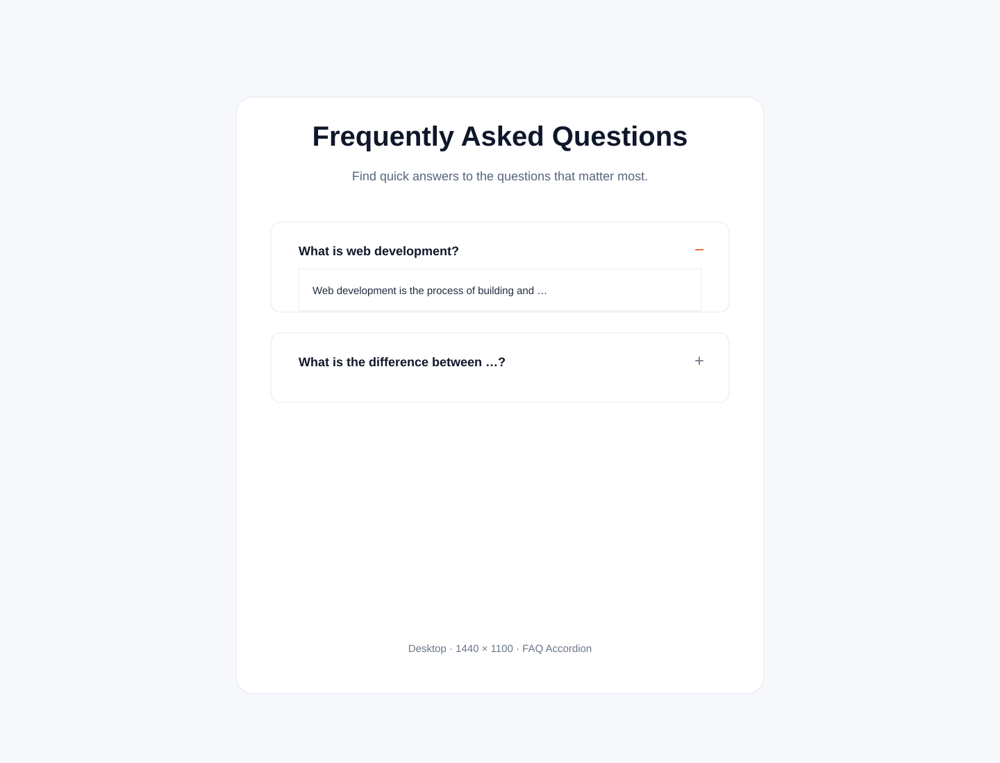
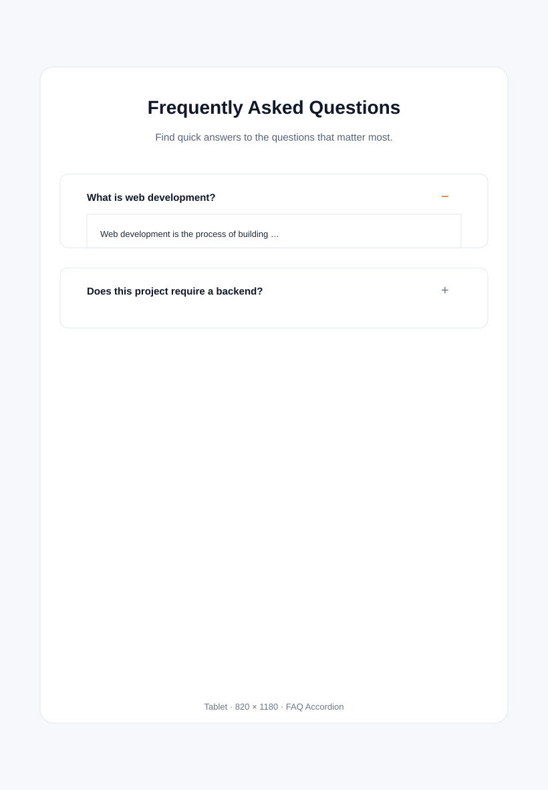
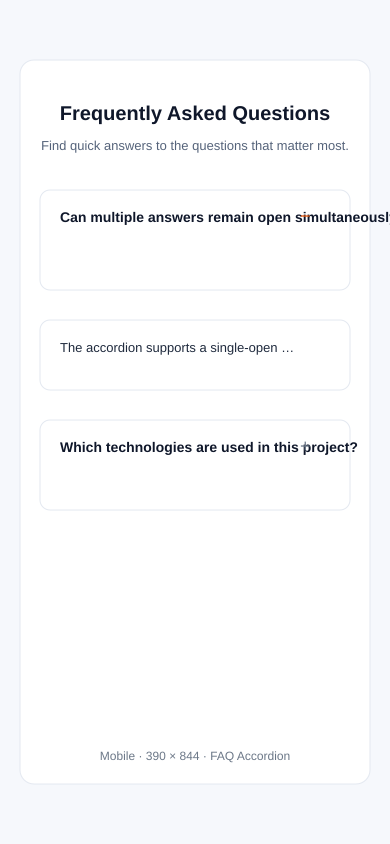

<div align="center">
  

  

  <p><b>Clean • Premium • Responsive • Accessible • Keyboard Friendly • No Frameworks</b></p>

  
  
  
  
  
  
  
  

</div>

---

<div align="center">
  
</div>

FAQ Accordion of **Abhishek Jadhav** — Web Developer & first-year BCA student at VIIT, Baramati. Built with **HTML5 + CSS3 + Vanilla JavaScript**: no frameworks, no libraries, no build step, and no backend. Click a question to expand its answer, click again to collapse — smooth animations throughout.

> **Internship attribution:** 45-day Web Development Internship at **Veda Technology** — Task 10: FAQ Accordion.

<details>
<summary><b>📖 Table of Contents (click to expand)</b></summary>

- [✨ Features](#-features)
- [🛠️ Technologies](#️-technologies)
- [🗂️ How the Accordion Is Built](#️-how-the-accordion-is-built)
- [💡 How the Accordion Works](#-how-the-accordion-works)
- [♿ Accessibility](#-accessibility)
- [⌨️ Keyboard Behaviour](#️-keyboard-behaviour)
- [📁 Project Structure](#-project-structure)
- [🚀 How to Run](#-how-to-run)
- [🔗 Profile Links](#-profile-links)
- [📜 JavaScript Concepts](#-javascript-concepts)
- [📸 Screenshots](#-screenshots)
- [🧪 Testing Checklist](#-testing-checklist)
- [🌐 Deployment](#-deployment)
- [⚠️ Limitations](#️-limitations)
- [🔍 Accuracy Notes](#-accuracy-notes)

</details>

## ✨ Features

<div align="center">
  
</div>

- **💬 10 FAQ items** — web development, HTML/CSS/JS, responsiveness, DOM manipulation, reusability, backend, and more — every question has a meaningful answer.
- **📖 Expand / collapse** — clicking a question opens its answer; clicking it again closes it. Every question works through one delegated event listener (no per-item hardcoding).
- **🔒 Single-open mode** — opening a question closes the previously open answer. Toggle to multiple-open with one flag in `script.js`.
- **⌨️ Full keyboard control** — real `<button>` elements: `Tab` reaches each question, `Enter`/`Space` toggle, visible `:focus-visible` ring, focus never gets lost.
- **♿ Accessible** — `aria-expanded` reflects open/closed state, `aria-controls` links each button to its answer panel, every panel has a unique ID, semantic HTML, and `prefers-reduced-motion` is respected.
- **🎞️ Smooth motion** — `max-height` measured from `scrollHeight` so long answers are never clipped, `opacity` and `padding` fade in/out, plus/minus icon rotates on open.
- **📱 Responsive** — verified from 320 px up; questions wrap, icons stay aligned on multi-line questions, tap targets ≥ 44 px on mobile.
- **🔢 Item counter** — live count of FAQ questions, derived from the data array.
- **📬 "Still need help?" footer** — contact support button.
- **🎨 Premium design** — light background, navy text (`#0f172a`), blue brand accents (`#2563eb`), rounded cards, subtle shadows, centered container, no excessive gradients.

---

## 🛠️ Technologies

| Technology | Use |
|------------|-----|
|  | Semantic landmarks, native `<button>`, `aria-expanded`/`aria-controls`, unique panel IDs, `skip-link` (`index.html`) |
|  | Custom properties, Flexbox, `clamp()`, transitions, `max-height` from `scrollHeight`, media queries, `prefers-reduced-motion`, `:focus-visible` (`style.css`) |
|  | IIFE + strict mode, data array, DOM creation, delegated click listener, `aria-expanded` sync, `window.faqApp` test hooks (`script.js`) |
|  | One flag `ALLOW_MULTIPLE_OPEN` switches between one-at-a-time and many-open behaviour |
|  | Zero dependencies — requirement compliant |
|  | System sans stack (no web-font request) |
|  + GitHub Pages | Version control + static hosting |

No React, Bootstrap, Tailwind or jQuery. Badge and typing images above are README-only; the app itself loads **nothing** from the network — it works fully offline.

---

## 🗂️ How the Accordion Is Built

The markup ships an **empty** FAQ list, and JavaScript fills it from a plain data array:

```js
const FAQS = [
  {
    question: 'What is web development?',
    answer: 'Web development is the process of building and maintaining websites and web applications using technologies such as HTML, CSS, and JavaScript.'
  },
  // ... 9 more
];
```

Each entry carries a `question` and an `answer`. Keeping **data separate from rendering** means the accordion grows by adding one object — no markup or event changes needed. The "Questions 10" counter in the header is also derived from the array at runtime, so it can never drift out of sync.

Each list item is built as:

```html
<li class="faq__item">
  <button type="button" class="faq__btn"
          id="faq-question-0"
          aria-controls="faq-answer-0"
          aria-expanded="false">
    <span class="faq__question">What is web development?</span>
    <span class="icon" aria-hidden="true">+</span>
  </button>
  <div class="faq__panel" id="faq-answer-0">
    <p>Web development is the process of …</p>
  </div>
</li>
```

Clicking any button delegates to **one** listener on the list rather than ten separate ones:

```js
dom.list.addEventListener('click', function (event) {
  const button = event.target.closest('.faq__btn');
  if (!button || !dom.list.contains(button)) return;
  const item = button.closest('.faq__item');
  if (item) toggleItem(item);
});
```

---

## 💡 How the Accordion Works

`toggleItem()` drives open/close:

```js
function toggleItem(item) {
  const isActive = item.classList.contains('is-active');

  if (!ALLOW_MULTIPLE_OPEN && !isActive) {
    closeAll(item);      // close every other open item first (single-open)
  }

  if (isActive) {
    closeItem(item);
  } else {
    openItem(item);
  }
}
```

`openItem()` measures the real content height so the transition never clips text:

```js
const fullHeight = panel.scrollHeight + 'px';
panel.style.maxHeight = fullHeight;
panel.style.opacity = '1';
item.classList.add('is-active');
button.setAttribute('aria-expanded', 'true');
```

`closeItem()` reverses it: removes `is-active`, sets `aria-expanded="false"`, animates `max-height` back to `0`. The `+` / `−` icon rotates via CSS, and the active border/shadow appears without relying on colour alone.

`style.css` animates `max-height`, `opacity` and `padding` together over ~300 ms with a `cubic-bezier` ease, so expansion and collapse feel premium and stay in sync.

---

## ♿ Accessibility

| Requirement | How it's met |
|-------------|--------------|
| Semantic HTML | `<section>`, `<ul>`, `<li>`, `<button>`, `<div>` panels, `<main>`, `<footer>` |
| Real buttons | Every question is a `<button type="button">` — focusable, activatable via Enter/Space |
| `aria-expanded` | Set to `"false"`/`"true"` on every open/close |
| `aria-controls` | Each button references its panel's unique ID |
| Unique panel IDs | `faq-answer-0` … `faq-answer-9` |
| Keyboard operable | Native button behaviour; `Tab`/`Enter`/`Space` all work |
| Visible focus | `:focus-visible` ring + soft background, honours High Contrast |
| Reduced motion | `prefers-reduced-motion: reduce` collapses transitions to instant |
| Colour not sole state | Icon rotates (`+`→`−`) + border + shadow + `aria-expanded` all signal state |

---

## ⌨️ Keyboard Behaviour

| Key | Behaviour |
|-----|-----------|
| `Tab` | Reaches each question button in document order |
| `Enter` / `Space` | Toggles the focused question open/closed |
| `Shift+Tab` | Moves focus backward through questions |
| Mouse click | Same toggle behaviour as keyboard |

---

## 📁 Project Structure

```text
internship-task-10/
├── index.html                                       # Semantic markup + skip link + footer
├── style.css                                        # Tokens, layout, animation, responsive
├── script.js                                        # FAQ data, rendering, expand/collapse logic
├── README.md                                        # This file
├── Veda_Technology_Task_10_Project_Report.md        # Internship project report
└── assets/
    ├── favicon.svg                                  # Orange/blue favicon
    ├── screenshot-desktop.svg                       # Desktop capture
    ├── screenshot-tablet.svg                        # Tablet capture
    └── screenshot-mobile.svg                        # Mobile capture
```

All paths are **relative** (`./style.css`, `./script.js`, `./assets/…`) for GitHub Pages compatibility.

---

## 🚀 How to Run

<div align="center">
  
</div>

No install or build step. ✨

1. 📂 Open the `internship-task-10` folder.
2. 🖱️ Double-click `index.html` → opens in Chrome / Edge / Firefox.
   - Or right-click `index.html` → **Open with** → your browser.
   - Or serve it: `python -m http.server 8000` → <http://localhost:8000>
   - Or VS Code **Live Server**: right-click `index.html` → **Open with Live Server**.
3. 🎉 Styling loads from `style.css`, logic from `script.js`, icon from `assets/favicon.svg`.

Quick syntax check (Node, from the project folder):

```powershell
node --check script.js
```

---

## 🔗 Profile Links

| Profile | Link |
|---------|------|
|  | https://github.com/0xAbhi13 |
|  | https://www.linkedin.com/in/0xabhi13/ |
|  | https://0xabhi13.github.io/MyPortfolio/ |

---

## 📜 JavaScript Concepts

| Concept | Where |
|---------|-------|
| Array of objects as data model | `FAQS` — 10 `{ question, answer }` entries |
| DOM creation | `buildItem()` creates each `<li><button>…<div>` with `createElement` |
| `DocumentFragment` | `renderFaqs()` appends all items in one insertion |
| Safe DOM writes | `textContent` for questions and answers (never `innerHTML`) |
| `getElementById` | One `dom` object built once for the list + counter |
| Event delegation | One `click` listener on the list + `event.target.closest('.faq__btn')` |
| Keyboard handler | `keydown` for `Enter`/`Space` to toggle |
| State flag | `const ALLOW_MULTIPLE_OPEN = false` — one-line switch to multi-open |
| `aria-expanded` sync | Set on every open/close; reflects true state |
| `scrollHeight` measurement | `panel.scrollHeight` drives `max-height` so nothing clips |
| IIFE + strict mode | `'use strict'` wrapper; `window.faqApp` exposed for console testing |
| `classList` | `toggle`/`add`/`remove` for `is-active` — no inline styles |

---

## 📸 Screenshots

**Desktop — accordion open**



**Tablet — single open item**



**Mobile — tap-friendly questions**



---

## 🧪 Testing Checklist

**Real browser:**

- [x] Page loads from `file://`; `style.css` applies and `script.js` executes; **no console errors**.
- [x] 10 FAQ items render, each a native `<button type="button">` wrapping a question + panel.
- [x] Every question has `aria-controls` + `aria-expanded="false"`; every panel has a unique ID.
- [x] Clicking a question expands its answer; clicking again collapses it.
- [x] Opening a second question closes the first (single-open mode).
- [x] `aria-expanded` flips to `"true"` on open and `"false"` on close.
- [x] Long answers are never clipped — `max-height` measured from `scrollHeight`.
- [x] `+` icon rotates to `−` on open; active border/shadow applied.
- [x] Visible `:focus-visible` ring on every button; keyboard `Tab`/`Enter`/`Space` work.
- [x] Layout has no horizontal scrolling at ~320 / 375 / 768 / 1024 / desktop widths.
- [x] `prefers-reduced-motion: reduce` collapses animation; accordion still opens/closes.
- [x] Works fully offline — no network requests at all.
- [x] `node --check script.js` passes.
- [x] All linked local files exist; all paths relative.

**Static / logic (Node 24):**

- [x] Doctype, `lang="en"`, UTF-8, viewport meta, one `<h1>`, meta description.
- [x] Every `<button>` declares `type="button"`; no inline `on*` handlers; no inline `<script>`.
- [x] No `eval()`, no `new Function()`, no `innerHTML`, no `document.write`; strict mode + IIFE.
- [x] All `getElementById()` targets exist in HTML.
- [x] CSS custom properties, transitions, media queries, `prefers-reduced-motion`, `:focus-visible`.
- [x] Dataset: 10 items, all questions + answers present, no duplicates.
- [x] FAQ counter reads `10` and matches `FAQS.length`.

---

## 🌐 Deployment

**GitHub Pages:**

```powershell
Set-Location "<path-to>\internship-task-10"
git init -b main
git add index.html style.css script.js README.md Veda_Technology_Task_10_Project_Report.md assets
git commit -m "Task 10: FAQ Accordion (HTML + CSS + JS)"
git remote add origin <your-repository-url>
git push -u origin main
```

Then GitHub → **Settings → Pages → Deploy from a branch → `main` / root** → GitHub shows your live URL.

> Keep `index.html`, `style.css`, `script.js`, and `assets/` together with relative links so Pages resolves them correctly. The repository URL above is a placeholder — replace it with your real repo.
> **Nothing has been committed or pushed yet, and no repository has been created**; the commands are provided for the submission step only.

---

## ⚠️ Limitations

- **Single-open by default** — only one answer open at a time. Set `ALLOW_MULTIPLE_OPEN = true` in `script.js` to allow many open.
- **No search or filtering** — out of scope for Task 10; the accordion stays minimal on purpose.
- **No data is stored or transmitted** — entirely client-side, no backend.
- **Animations use `max-height`** with a generous upper bound (`2000px`); answers taller than that would clip (none of the 10 answers approach this).

---

## 🔍 Accuracy Notes

- Every test result above comes from checks executed against these files — no invented numbers.
- Ten FAQ items match the required list exactly; every question has its specified answer.
- ARIA attributes (`aria-expanded`, `aria-controls`, unique IDs) are present and correct in markup.
- Alt/decorative icons are `aria-hidden="true"` so screen readers are not diluted.
- Skills are presented as *learning/using* at internship level.
- The app makes no network requests; README badges and typing images are documentation-only.

---

<div align="center">
  
  <p><sub>Veda Technology Internship — Task 10: FAQ Accordion • HTML5 • CSS3 • Vanilla JavaScript ✨</sub></p>
</div>
